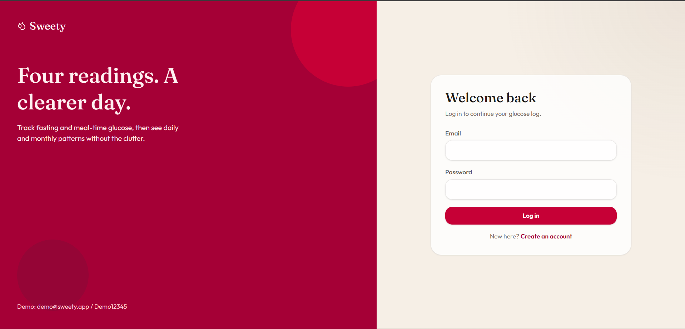
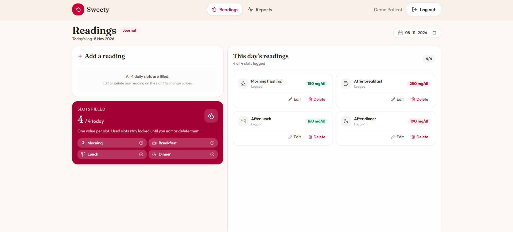
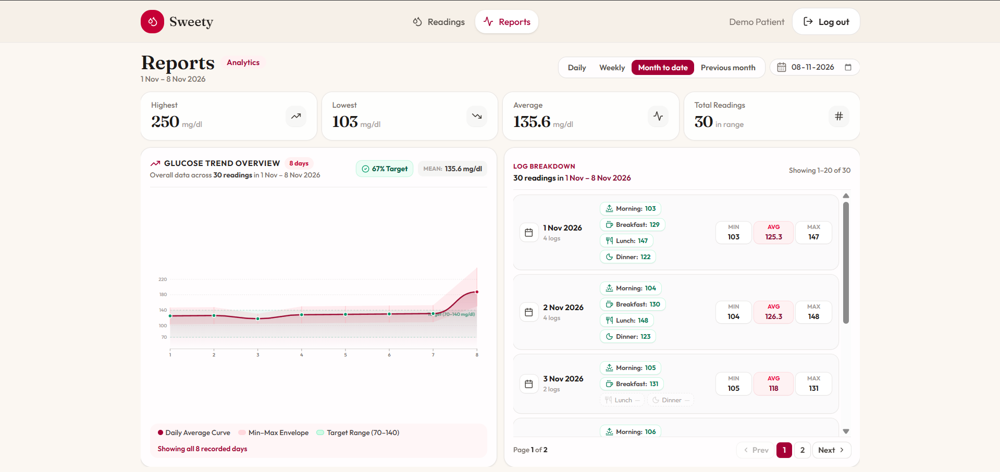
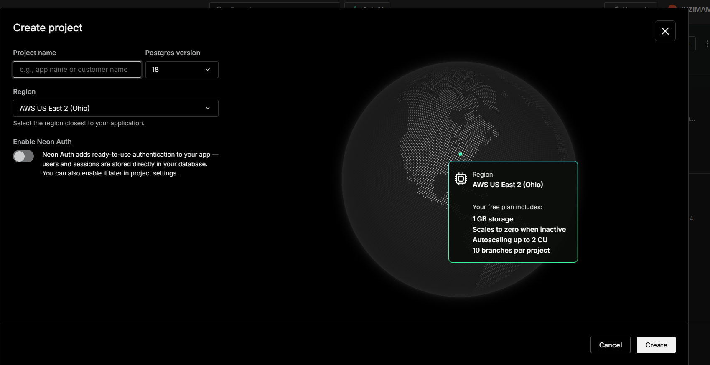
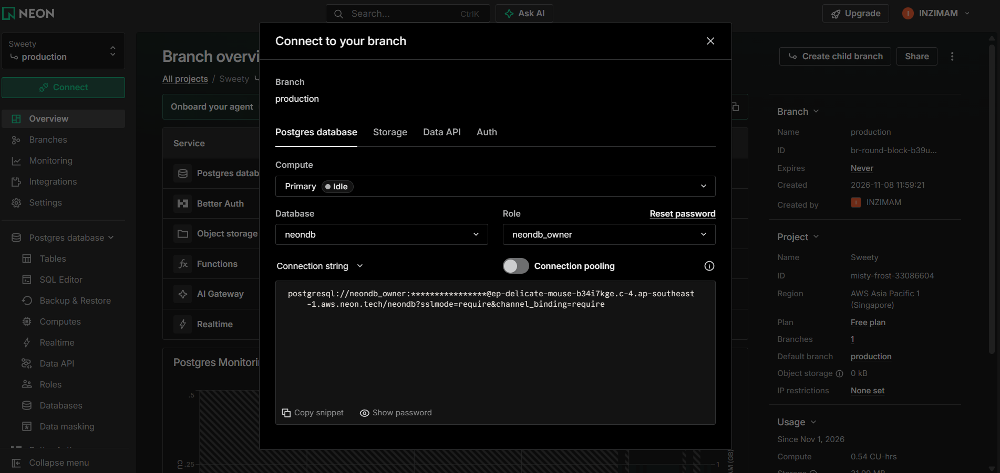

# Sweety – Blood Glucose Tracker

Kenpath assignment: a patient logs up to four blood glucose readings a day and views daily, month-to-date, and previous-month reports.

**Demo video:** [Watch here](ADD_LINK)  
**Live app:** ADD_LINK (optional)

## Screenshots

| Login | Readings |
|---|---|
|  |  |

| Reports |
|---|
|  |

## Stack

- **Frontend:** React 19, Vite, Tailwind CSS v4, React Router v7, Axios, Framer Motion, Lucide React
- **Backend:** Node.js, Express (ES modules), `pg` (node-postgres), Zod, Helmet, CORS
- **Auth:** bcrypt + JWT
- **Database:** Neon serverless PostgreSQL (plain Postgres, no ORM)

## Project Structure

```
sweety-BE/    Express API, db scripts (schema, seed)
sweety-FE/    React + Vite client
screenshots/  README images
```

## Quick Start

> Run every command from the **repository root** (the folder that contains `sweety-BE` and `sweety-FE`) unless a step says otherwise.

### 1. Install

```bash
cd sweety-BE
npm install
cd ../sweety-FE
npm install
cd ..
```

### 2. Create the Neon database

1. Log in at [neon.tech](https://neon.tech).
2. Click **New project** (top left), give it a name, and create it.

   

3. After the project is created, click **Connect** (top left of the project dashboard). The connection dialog opens.

   

4. Copy the two connection strings:
   - Turn **Connection pooling OFF**, copy the string, and keep it for `DIRECT_URL`.
   - Turn **Connection pooling ON**, copy the string, and keep it for `DATABASE_URL`.

| Variable | Pooling | Host looks like | Used for |
|---|---|---|---|
| `DIRECT_URL` | OFF | `ep-xxxx.region.aws.neon.tech` | Schema setup and seeding |
| `DATABASE_URL` | ON | `ep-xxxx-pooler.region.aws.neon.tech` | API runtime queries |

> Both strings must end with `?sslmode=require`. If the password is hidden, click **Reset password** in the dialog and copy the new string.

### 3. Environment variables

From the repository root:

```bash
cp sweety-BE/.env.example sweety-BE/.env
cp sweety-FE/.env.example sweety-FE/.env
```

This works in macOS/Linux terminals, Git Bash and Windows PowerShell.

Open `sweety-BE/.env` and paste your strings:

```env
PORT=4000
DIRECT_URL=<paste the pooling OFF string here>
DATABASE_URL=<paste the pooling ON string here>
JWT_SECRET=change_me
JWT_EXPIRES_IN=7d
CORS_ORIGIN=http://localhost:5173
```

| Variable | Description |
|---|---|
| `PORT` | API port (default `4000`) |
| `DIRECT_URL` | Neon **direct** connection string (pooling off), used for schema setup and seeding |
| `DATABASE_URL` | Neon **pooled** connection string (pooling on), used by the API |
| `JWT_SECRET` | Secret used to sign JWTs (use any long random string) |
| `JWT_EXPIRES_IN` | Token lifetime, e.g. `7d` |
| `CORS_ORIGIN` | Frontend origin, e.g. `http://localhost:5173` |

`sweety-FE/.env` needs one value:

```env
VITE_API_URL=http://localhost:4000
```

### 4. Create tables and seed demo data

```bash
cd sweety-BE
npm run db:init
```

`db:init` runs `npm run setup` (applies the schema) and then `npm run seed` (demo user and readings). The seed is safe to re-run.

### 5. Run the backend

In the same terminal (you are already in `sweety-BE`):

```bash
npm run dev
```

API: `http://localhost:4000` · Health check: `GET /health`

### 6. Run the frontend

Open a **second terminal at the repository root**:

```bash
cd sweety-FE
npm run dev
```

App: `http://localhost:5173`

## Demo Credentials

- **Email:** `demo@sweety.app`
- **Password:** `Demo12345`

The seed contains readings for all of October 2026 and 1–7 November 2026. Pick a date within that range in the report date picker to see complete data. (Local demo credentials only.)

## Available Scripts

**Backend (`sweety-BE`)**

| Command | Description |
|---|---|
| `npm run dev` | Start the API with auto-reload |
| `npm run start` | Start the API in production mode |
| `npm run setup` | Apply the database schema using `DIRECT_URL` |
| `npm run seed` | Seed the demo user and sample readings |
| `npm run db:init` | Run `setup`, then `seed` |

**Frontend (`sweety-FE`)**

| Command | Description |
|---|---|
| `npm run dev` | Start the Vite dev server |
| `npm run build` | Build production assets to `dist/` |
| `npm run preview` | Preview the production build |
| `npm run lint` | Run ESLint |

## API Reference

| Method | Path | Auth | Description |
|---|---|---|---|
| POST | `/auth/register` | Public | Register a patient (`name`, `email`, `password`) |
| POST | `/auth/login` | Public | Log in and receive a JWT |
| GET | `/auth/me` | JWT | Current user profile |
| POST | `/readings` | JWT | Create a reading |
| GET | `/readings?date=YYYY-MM-DD` | JWT | List readings for a date |
| PUT | `/readings/:id` | JWT | Update a reading |
| DELETE | `/readings/:id` | JWT | Delete a reading |
| GET | `/reports/daily?date=YYYY-MM-DD` | JWT | Readings and stats for the day |
| GET | `/reports/weekly?date=YYYY-MM-DD` | JWT | Last 7 days ending on the date |
| GET | `/reports/month-to-date?date=YYYY-MM-DD` | JWT | 1st of the month up to the selected date |
| GET | `/reports/monthly?date=YYYY-MM-DD` | JWT | Previous month relative to the selected date |

Protected routes expect `Authorization: Bearer <token>`.

**Reading payload**

```json
{ "date": "YYYY-MM-DD", "slot": "After lunch", "value": 140 }
```

Allowed slots: `Morning (fasting)`, `After breakfast`, `After lunch`, `After dinner`.

## Notes & Architecture

- **Database:** plain PostgreSQL on Neon through `pg.Pool` with SSL. No ORM and no Supabase SDK. The pooled URL serves the API and the direct URL serves schema setup and seeding.
- **Date handling:** Postgres `DATE` values (OID 1082) are returned as `YYYY-MM-DD` strings in `src/config/db.js`, which avoids timezone drift between UTC and local time.
- **Data isolation:** enforced in the application layer with JWT authentication (`requireAuth`) and parameterized queries scoped by `WHERE user_id = $1`.
- **Validation order:** required fields → integer range (40–600 mg/dL) → no future dates → duplicate slot (also guarded by the `readings_user_date_slot_unique` constraint, error code `23505`) → maximum 4 readings per day.
- **Security:** passwords are hashed with bcrypt (cost 10), and `password_hash` is never returned in responses. The demo credentials and `JWT_SECRET=change_me` are for local use only.

### Future Improvements

- **Rate limiting** on auth and API endpoints.
- **Caching** of frequently requested reports.
- **Doctor role** (role-based access so doctors can view their patients' reports read-only), to be developed on a separate branch.